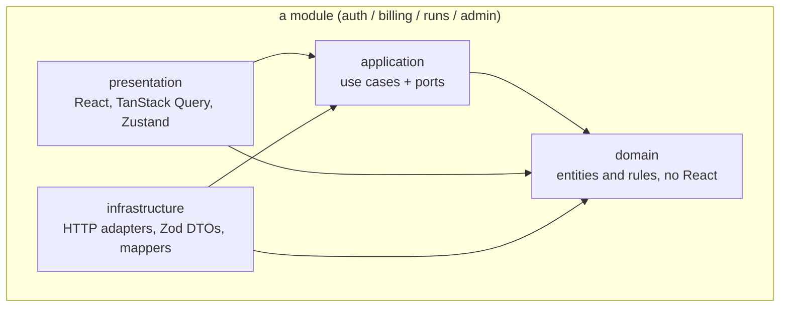
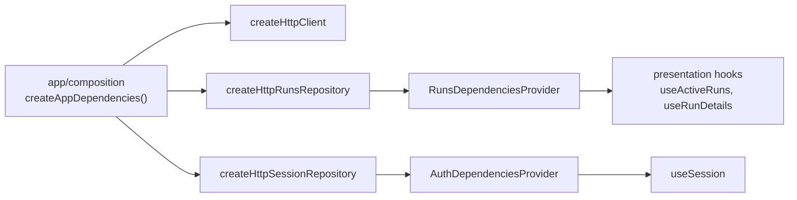

# Frontend architecture

_Русская версия: [FRONTEND_ARCHITECTURE.ru.md](./FRONTEND_ARCHITECTURE.ru.md)_

## 1. Product and scope

The product is a SaaS code review service for GitHub. The backend runs as a GitHub App:
it reacts to pull request events, builds a bounded context around the diff, asks an LLM
for findings, validates them and **publishes them into the pull request** as review
comments and suggestions.

The frontend is not where code review happens — that stays on GitHub. It is the console
of the service:

| Area         | Audience  | Purpose                                               |
| ------------ | --------- | ----------------------------------------------------- |
| Billing      | customers | plans, subscription, seat usage                       |
| Agent runs   | customers | runs in flight, history, and what the agent published |
| Repositories | customers | the repositories the app reviews, and connecting more |
| Admin        | our team  | every subscription, read-only                         |

Out of scope on purpose: reviewing code in our UI, replying to findings, applying
suggestions. All of that lives in the pull request.

## 2. Layers

Clean Architecture is applied **inside each module**, and modules are the top-level unit:



The dependency rule points inwards: `domain` knows nothing, `application` defines the
ports it needs, `infrastructure` implements them, `presentation` calls use cases. Nothing
but `infrastructure` knows that HTTP exists.

## 3. Folder structure

```text
src/
  app/                       composition root
    composition/             builds adapters and hands them to the modules
    config/                  env validated with Zod at startup
    layouts/                 console shell: top bar, account menu, sidebar, mobile drawer
    pages/                   pages that compose several modules (the Overview)
    providers/               query client, DI providers, theme
    routes/                  the route tree, guards, typed search params
    styles/                  Tailwind entry point and semantic tokens
  modules/
    auth/                    session, organisations, permissions
    billing/                 plans and subscription (placeholder screens)
    runs/                    agent runs, findings, run details
    repositories/            connected repositories, connecting more via GitHub
    admin/                   platform admin area (lazy, isolated)
      domain/ application/ infrastructure/ presentation/ index.ts
  shared/
    diff/                    the diff viewer: domain/ + presentation/
    di/                      generic dependency-injection context factory
    lib/                     http client, error kinds, Intl formatters
    mocks/                   MSW handlers, state snapshot, scenario switch
    ui/                      shadcn/ui components (Radix)
```

Rules, enforced by `eslint-plugin-boundaries` (see `eslint.config.ts`):

- inside a module, imports follow the layer direction above;
- a module may import another module **only through its `index.ts`**;
- `shared/` never imports from `modules/`;
- no module imports `admin`; only the router in `app/` does, lazily;
- each `.tsx` file exports one component, named after the file; private helpers may stay
  while they are small and stateless (`shared/ui`, vendored from shadcn, is exempt).

A violation fails `pnpm lint`, which is what keeps the architecture from eroding.

## 4. Dependency injection

There is no DI container. The composition root builds the adapters and passes them down
through React context:



Use cases are plain functions taking their ports as the first argument, so a test can
call them with an in-memory repository and no React at all.

## 5. State

| Kind                     | Where it lives     | Example                                                      |
| ------------------------ | ------------------ | ------------------------------------------------------------ |
| Server data              | TanStack Query     | runs, run details, session                                   |
| Session credential       | `HttpOnly` cookie  | never visible to JavaScript                                  |
| Shareable UI state       | URL (typed search) | status filter, repository, author, search                    |
| Ephemeral UI state       | Zustand            | unfolded context, collapsed findings, the "connected" banner |
| One persisted preference | Zustand + persist  | theme                                                        |

Active runs poll every 3 seconds **while anything is still running** and stop on their
own once every run reaches a terminal status:

```ts
refetchInterval: (query) =>
  query.state.data && hasActiveRun(query.state.data) ? 3000 : false;
```

History uses cursor pagination (`useInfiniteQuery`), so a run that starts while you read
never shifts the page under you.

## 6. Data contract

The runs module speaks the backend's jobs API, specified in
`dmc-268-api-t4/docs/openapi.yaml`; MSW serves the same shapes in development and in the
demo build. The console calls a job a **run**; only `infrastructure/` knows the wire names.

| Endpoint                                                         | Used for                                     |
| :--------------------------------------------------------------- | :------------------------------------------- |
| `GET /api/jobs?status=active`                                    | the "Active now" panel and the Overview card |
| `GET /api/jobs?status=&repository=&author=&from=&to=&q=&cursor=` | the history                                  |
| `GET /api/jobs/{job_id}`                                         | the run page: job, `stage`, steps, findings  |
| `GET /api/jobs/{job_id}/findings/{finding_id}/context`           | the code under one finding                   |
| `GET /api/jobs/{job_id}/file-lines?path=&from=&to=`              | unfolding context                            |

The mappers bridge two differences:

- **Status.** The API keeps the job `status` (`QUEUED`, `PROCESSING`, `RETRYING`,
  `COMPLETED`, `FAILED`, `SUPERSEDED`, `SKIPPED`) apart from the pipeline `stage`
  (`collecting_context` … `publishing`). The badge shows the stage while a job is
  `PROCESSING`; the list carries no stage, so a job there reads "In progress".
- **Stages.** The timeline's four stages are folded from `steps`, each of which carries its
  `stage`; only the latest `attempt` counts, so a retry does not stretch the stages.

The diff arrives **structured**, not as raw unified diff text, and **separately from the
finding**: the API rebuilds it from the forge on request and stores nothing, so it can
answer `409` for an old review.

```jsonc
// GET /api/jobs/{job_id}/findings/{finding_id}/context
{
  "path": "src/payment_service.rb",
  "old_path": null,
  "status": "modified",
  "file_line_count": 180,
  "hunks": [
    { "id": "…", "new_start": 138, "lines": [{ "type": "added", "…": "" }] },
  ],
}
```

Other endpoints: `GET /api/me`, and for signing in
`GET /api/auth/github` (a page navigation), `GET /api/auth/github/callback` (GitHub's
redirect, handled by the backend) and `POST /api/auth/logout`. Repositories:
`GET /api/repositories?cursor=` (with `total_count`), `GET /api/repositories/connect-url` and
`GET /api/repositories/{id}/disconnect-url`
(see [Spec 002](./docs/specs/002-account-layout.md)).

Every response passes a Zod schema in `infrastructure/dto.ts` before mappers turn it into
domain types. A finding whose context cannot be loaded, or whose position is not part of
the context, is shown **without code**: its `path:line`, the comment and the link to
GitHub, never anchored to the wrong line (`getFindingContext`, `isPositionInDiff`).

### Authentication

The session is **cookie-only**: the backend runs the GitHub sign-in, keeps every
credential, and gives the browser an `HttpOnly; Secure; SameSite=Strict` cookie that
JavaScript cannot read. The SPA and `/api` are served from the same site. The full design
is in [Spec 001](./docs/specs/001-github-auth.md).

- **Sign-in.** `/login` links to `GET /api/auth/github?return_to=…`. The backend redirects
  back to `/auth/callback?result=…&return_to=…`; the callback loads `/me` and opens
  `return_to`. A direct sign-in, or a user whose organisations lack the app, lands on
  `/auth/success`. `return_to` must be a local path (`sanitizeReturnTo`), so sign-in
  cannot become an open redirect.
- **CSRF.** Every request carries `X-Requested-With: fetch`; the backend rejects
  state-changing requests without it or from a foreign `Origin`.
- **Lost session.** A `401` from any endpoint other than `/me` calls the HTTP client's
  `onUnauthorized` hook: the app drops the cached data and opens
  `/login?returnTo=<current page>`.
- **Sign-out.** `POST /api/auth/logout`, then the cache is cleared and the other tabs are
  told through `BroadcastChannel("auth")`.

## 7. Diff viewer

```text
FindingCard                     severity, category, collapse  (modules/runs)
└── DiffSnippet                 file fragment                 (shared/diff)
    ├── DiffFileHeader          path, status, link to GitHub
    ├── ExpandContextRow        "↑ 20 lines", "All", hidden line count
    ├── DiffHunk                @@ header + lines
    │   └── DiffLine            gutters, +/- marker, highlight, anchor
    │       └── LineContent     the text — the single extension point for
    │                           syntax highlighting later
    ├── InlineFinding           the agent's comment under its line
    └── SuggestionBlock         proposed change as a mini diff
```

Pure logic in `shared/diff/domain` (covered by tests):

| Function             | What it answers                                              |
| -------------------- | ------------------------------------------------------------ |
| `getContextGaps`     | which unchanged stretches can be unfolded, and how big       |
| `expandRange`        | which line range one "unfold" click should fetch             |
| `mergeExpandedLines` | how fetched lines merge back, keeping both numberings right  |
| `findLinePosition`   | which line a finding points at                               |
| `isPositionInDiff`   | whether a finding position exists in the diff at all         |
| `positionAnchorId`   | the deep-link id for a line (`#src-payment_service-rb-R142`) |

Deliberately left out for now, with the seams kept open: syntax highlighting (only
`LineContent` changes), split view (`DiffLine` already takes a side), word-level diff,
virtualisation.

## 8. Application state mock

`src/shared/mocks/state.ts` is the typed snapshot the DoD asks for: a session per role, an
active run, a completed run with three findings (including a suggestion), a failed run
with a reason, and a page of history. It is written in the wire format, so it exercises the
Zod schemas and the mappers exactly like a real backend would — including one finding
pointing outside the diff, which the mappers must drop.

`?mock=owner|member|admin|idle` (or the panel in the corner) switches role and whether any
runs are active, which is how guards and empty states are checked without editing
fixtures. The sign-in scenarios are `signed-out`, `denied` (sign-in cancelled on GitHub),
`no-orgs` (the app is installed nowhere) and `expired` (the session ends on the second
request). MSW cannot intercept the trip to GitHub, so in mock mode "Continue with GitHub"
goes straight to the callback, and the mock session (in `localStorage`) starts when a page
loads on a successful callback. `no-repos` has an organisation without connected
repositories; in mock mode "Connect repository" adds one and returns to
`/repositories?connected=1`, the way GitHub's Setup URL would.

## 9. Tooling

pnpm 12 · Node ≥ 24 · React 19 · Vite 8 · TypeScript 6 · TanStack Router and Query ·
Zustand · Zod 4 · Tailwind v4 + shadcn/ui (Radix) · MSW · Vitest.

`pnpm lint` (ESLint 10, type-aware, with architecture boundaries), `pnpm lint:css`,
`pnpm check-types`, `pnpm test`, `pnpm build`. Husky runs lint-staged on commit and the
full set on push; commit messages follow Conventional Commits. The same checks, plus
`format:check`, run on every pull request in GitHub Actions — hooks can be skipped with
`--no-verify`, CI cannot.

## 10. Decisions and their reasons

| Decision                                   | Why                                                                         |
| ------------------------------------------ | --------------------------------------------------------------------------- |
| Clean Architecture inside vertical modules | billing, runs and admin share almost nothing; each stays in one folder      |
| Manual DI over a container                 | no decorators, no runtime magic, trivial to fake in tests                   |
| Query for server state, Zustand for UI     | one cache, no duplicated server data                                        |
| Filters in the URL                         | a filtered history is a shareable link                                      |
| Polling instead of SSE                     | works against any backend today; the cadence is invisible to the user       |
| Structured diff from the API               | unambiguous line numbers; position validation without parsing on the client |
| Stripe hosted checkout                     | no card data ever reaches our UI                                            |
| Read-only admin area                       | Stripe stays the source of truth for money                                  |
| No syntax highlighting yet                 | costly on CPU and in scope; the extension point is one component            |

## 11. Next steps

Billing screens and Stripe redirects, the admin table, the public pricing page, syntax
highlighting, split view, SSE instead of polling, component and e2e tests.
